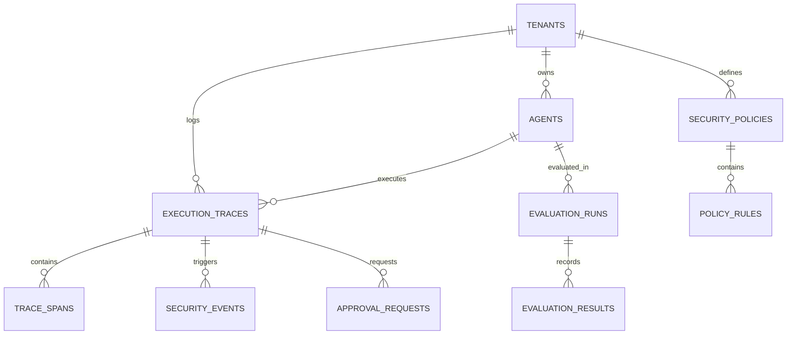

# SentinelAI – Enterprise Agent Security & Evaluation Platform
## System Architecture & Technical Specification

**Version:** 1.0.0-PROD-SPEC  
**Author:** Principal Software Architect & Lead Engineering Agent  
**Date:** November 2026  
**Status:** Approved for Implementation

---

## 1. Executive Overview

**SentinelAI** is an enterprise-grade security gateway, runtime firewall, and continuous evaluation platform for autonomous AI agents and Retrieval-Augmented Generation (RAG) systems. It delivers zero-trust security controls, deterministic policy enforcement, human-in-the-loop (HITL) authorization for critical actions, full-lifecycle observability, and rigorous adversarial evaluation.

### Core Architectural Principles
1. **Zero-Trust Agent Runtime**: Every input, retrieval chunk, tool invocation, and LLM output is untrusted by default and must pass through dedicated policy guards.
2. **Absolute Data Integrity**: No fabricated, hardcoded, or pseudo-random metrics. Dashboard telemetry reflects only verified, database-persisted execution records.
3. **Environment Segregation**: Mock/testing executions and live production traces are strictly partitioned across databases, queries, and analytics.
4. **Deterministic Fallbacks**: Systems must operate reliably with local/mock LLMs and local vector stores when external API keys or networks are not configured.
5. **High-Performance Asynchronous Design**: Sub-millisecond policy evaluation pipelines built on Python 3.12+ `asyncio`, FastAPI, and SQLAlchemy 2 async engines.

---

## 2. High-Level System Architecture

```
                                  +---------------------------------------+
                                  |            Client Layer               |
                                  |   (React 18 + Vite + TS + Tailwind)   |
                                  +-------------------+-------------------+
                                                      |
                                          REST / WebSocket / SSE
                                                      |
                                                      v
+---------------------------------------------------------------------------------------------------+
|                                 SentinelAI Gateway (FastAPI 0.115+)                               |
|                                                                                                   |
|  +--------------------+  +---------------------+  +--------------------+  +---------------------+ |
|  | Auth & Tenant RBAC |  | Rate Limiting Engine |  | API Routing Layer  |  | Trace Context Inject| |
|  +--------------------+  +---------------------+  +--------------------+  +---------------------+ |
+-----------------------------------------------------+---------------------------------------------+
                                                      |
                                                      v
+---------------------------------------------------------------------------------------------------+
|                                SentinelAI Security Firewall Core                                  |
|                                                                                                   |
|  [STAGE 1: Ingress Guard]                                                                         |
|  +---------------------------+  +--------------------------+  +---------------------------------+ |
|  | Prompt Injection Detector |  | Jailbreak Pattern Filter |  | PII Redaction & Tokenizer Engine| |
|  +---------------------------+  +--------------------------+  +---------------------------------+ |
|                                                      |                                            |
|                                                      v                                            |
|  [STAGE 2: Agent Orchestrator - LangGraph]                                                        |
|  +---------------------------------------------------------------------------------------------+  |
|  | StateGraph Execution Engine: Prompt -> RAG -> Tool Planner -> Executor -> Synthesizer      |  |
|  +---------------------------------------------------------------------------------------------+  |
|         |                                      |                                  |               |
|         v                                      v                                  v               |
|  [Hybrid RAG Engine]                  [Tool Policy Engine]              [LLM Provider Gateway]    |
|  - Qdrant Vector DB (Dense)           - Tool Authorization (ABAC)       - Groq / OpenAI API       |
|  - BM25 Ranker (Sparse)               - Argument Schema Validation      - Deterministic Mock LLM  |
|  - Cross-Encoder Reranker             - HITL Approval Interceptor       - Token/Cost Calculator   |
|  - Context Injection Filter           - Execution Sandbox Bridge        - Fallback Circuit Breaker|
|                                                      |                                            |
|                                                      v                                            |
|  [STAGE 3: Egress Guard]                                                                          |
|  +---------------------------+  +--------------------------+  +---------------------------------+ |
|  | Output PII Masker         |  | Hallucination Checker    |  | Sensitive Data Leakage Guard    | |
|  +---------------------------+  +--------------------------+  +---------------------------------+ |
+-----------------------------------------------------+---------------------------------------------+
                                                      |
                         +----------------------------+----------------------------+
                         |                                                         |
                         v                                                         v
+--------------------------------------------------+     +------------------------------------------+
|          Evaluation & Red-Teaming Suite          |     |           Observability Core             |
|  - RAGAS (Faithfulness, Relevance, Context)      |     |  - Async Execution Traces & Spans        |
|  - Adversarial Attack Suite (100+ Test Vectors)  |     |  - Token, Latency & Cost Accounting     |
|  - Automated Policy Regression Benchmarking      |     |  - Langfuse-compatible OpenTelemetry Log|
|  - Security Robustness Scorecards                |     |  - PostgreSQL Persistence                |
+--------------------------------------------------+     +------------------------------------------+
```

---

## 3. Component Deep Dive

### 3.1 SentinelAI Ingress & Egress Security Engine
The security engine processes queries and responses through modular analyzers with millisecond latency:
- **Prompt Injection Analyzer**:
  - Dual-phase detection: Heuristic/regex signature scanning for known jailbreak vectors (DAN, roleplay, cognitive bypass, instruction overrides) + semantic similarity scoring against vector-indexed adversarial samples.
  - Severity classification: `LOW`, `MEDIUM`, `HIGH`, `CRITICAL`.
- **PII Guard**:
  - Pattern matching for Email, Phone Numbers, Social Security Numbers (SSN), Credit Card PANs, IP Addresses, and API Key patterns.
  - Anonymization strategies: Complete Redaction (`[REDACTED]`), Cryptographic Pseudonymization (`<HASH_TOKEN>`), or Masking (`4111-XXXX-XXXX-1111`).
- **Tool Policy & HITL Engine**:
  - Every tool has assigned risk tiers: `Tier 1: Read-Only`, `Tier 2: Stateful Change`, `Tier 3: Critical External Action` (e.g. database DROP, fund transfer, external webhook).
  - Tiers 2 & 3 trigger attribute-based access control (ABAC). Tier 3 generates an interactive `ApprovalRequest` record, suspending the LangGraph run state until authorized by an administrator.
- **Output Sanitization Guard**:
  - Validates that responses conform to strict schema criteria, do not expose system prompts or proprietary RAG context, and do not contain residual PII.

### 3.2 LangGraph Agent Runtime & Provider Abstraction
- **Unified Provider Protocol**: Implements `BaseLLMProvider` supporting Groq API, OpenAI API, and a built-in `MockLLMProvider` for deterministic testing.
- **Deterministic Mock LLM Engine**:
  - Provides reliable responses without network access or paid API keys.
  - Supports scriptable rule-based responses, tool call simulations, and adversarial responses for testing defenses.
  - Every execution records `is_mock=True` to enforce the Mandatory Data Integrity Policy.
- **StateGraph Architecture**:
  - Clean separation of nodes: `guard_input -> retrieve_context -> plan_tools -> authorize_tools -> execute_tools -> synthesize_response -> guard_output`.
  - Checkpointed state using PostgreSQL/Memory checkpointer for state resumption following HITL approvals.

### 3.3 Hybrid RAG Pipeline
- **Vector Storage**: Qdrant running in-memory or Dockerized, handling dense embeddings.
- **Dense Embeddings**: `sentence-transformers/all-MiniLM-L6-v2` (or lightweight mock embeddings for zero-dependency execution).
- **Lexical Search**: In-memory BM25 tokenizer for keyword precision.
- **Fusion**: Reciprocal Rank Fusion (RRF) with configurable $k=60$ parameter.
- **Cross-Encoder Reranker**: Precision reranking of top-K results.
- **RAG Security Scrubber**: Inspects retrieved chunks for indirect prompt injection attempts before injection into the agent's prompt context.

### 3.4 Continuous Evaluation & Red-Teaming (RAGAS + Adversarial Benchmark)
- **RAGAS Integration**:
  - Faithfulness: Verification that answers are grounded in retrieved context.
  - Answer Relevance: Semantic match between query intent and agent output.
  - Context Precision: Signal-to-noise ratio of retrieved knowledge chunks.
- **Adversarial Benchmark**:
  - Native dataset of adversarial prompt injections, privilege escalation attempts, PII exfiltration traps, and jailbreaks.
  - Automated test runner generating standardized vulnerability reports and defense efficacy scores.

### 3.5 Observability & Trace Pipeline
- Full OpenTelemetry and Langfuse compatibility.
- Trace tree structure: `Trace` -> `Span` (Guard, Retrieval, Generation, Tool).
- Real-time token consumption, estimated USD cost, and latency breakdown per node.
- Structured JSON logging with tenant ID, trace ID, and session isolation.

---

## 4. Database Schema & Entity Relationships

The relational layer is managed by **SQLAlchemy 2.0 Async** with **PostgreSQL** (with SQLite fallback for local development).



### Table Definitions:

1. **`tenants`**: Multi-tenancy and organization isolation.
   - `id` (UUID, PK), `name` (String), `created_at` (DateTime), `is_active` (Boolean).
2. **`agents`**: Registered autonomous agents monitored by SentinelAI.
   - `id` (UUID, PK), `tenant_id` (FK), `name` (String), `description` (Text), `model_provider` (String), `model_name` (String), `temperature` (Float), `system_prompt` (Text), `created_at` (DateTime), `is_active` (Boolean).
3. **`security_policies`**: Policy profiles assigned to agents.
   - `id` (UUID, PK), `tenant_id` (FK), `name` (String), `description` (Text), `is_default` (Boolean), `prompt_injection_threshold` (Float), `jailbreak_block_level` (String), `pii_action` (String: `BLOCK`, `REDACT`, `FLAG`), `require_tool_approval` (Boolean), `created_at` (DateTime).
4. **`policy_rules`**: Granular rules for tools and content checks.
   - `id` (UUID, PK), `policy_id` (FK), `rule_type` (Enum: `TOOL_RESTRICTION`, `PROMPT_DENYLIST`, `REGEX_PATTERN`), `target` (String), `parameters` (JSONB), `action` (Enum: `ALLOW`, `REQUIRE_APPROVAL`, `BLOCK`).
5. **`execution_traces`**: Root execution record for every agent invocation.
   - `id` (UUID, PK), `tenant_id` (FK), `agent_id` (FK), `session_id` (String), `input_prompt` (Text), `sanitized_input` (Text), `output_response` (Text), `sanitized_output` (Text), `status` (Enum: `SUCCESS`, `BLOCKED`, `PENDING_APPROVAL`, `ERROR`), `is_mock` (Boolean), `total_tokens` (Integer), `prompt_tokens` (Integer), `completion_tokens` (Integer), `total_latency_ms` (Float), `estimated_cost_usd` (Float), `started_at` (DateTime), `completed_at` (DateTime).
6. **`trace_spans`**: Sub-operation breakdown within an execution trace.
   - `id` (UUID, PK), `trace_id` (FK), `parent_span_id` (UUID, Nullable), `name` (String), `span_type` (Enum: `GUARD_INPUT`, `RETRIEVAL`, `LLM_CALL`, `TOOL_EXECUTION`, `GUARD_OUTPUT`), `input_data` (JSONB), `output_data` (JSONB), `latency_ms` (Float), `tokens` (Integer), `status` (String), `created_at` (DateTime).
7. **`security_events`**: Audit log of all detected security incidents.
   - `id` (UUID, PK), `trace_id` (FK), `event_type` (Enum: `PROMPT_INJECTION`, `JAILBREAK_ATTEMPT`, `PII_DETECTED`, `UNAUTHORIZED_TOOL`, `DATA_LEAK`), `severity` (Enum: `LOW`, `MEDIUM`, `HIGH`, `CRITICAL`), `confidence_score` (Float), `detector_name` (String), `details` (JSONB), `action_taken` (String: `BLOCKED`, `REDACTED`, `LOGGED`), `created_at` (DateTime).
8. **`approval_requests`**: Human-In-The-Loop approval queue for restricted tool executions.
   - `id` (UUID, PK), `trace_id` (FK), `tool_name` (String), `tool_arguments` (JSONB), `status` (Enum: `PENDING`, `APPROVED`, `REJECTED`, `EXPIRED`), `requested_at` (DateTime), `reviewed_at` (DateTime, Nullable), `reviewer_id` (String, Nullable), `rejection_reason` (Text, Nullable).
9. **`evaluation_runs`**: Benchmark runs for continuous evaluation.
   - `id` (UUID, PK), `agent_id` (FK), `dataset_name` (String), `total_samples` (Integer), `status` (Enum: `RUNNING`, `COMPLETED`, `FAILED`), `faithfulness_score` (Float), `relevance_score` (Float), `security_robustness_score` (Float), `is_mock` (Boolean), `started_at` (DateTime), `completed_at` (DateTime).
10. **`evaluation_results`**: Individual item test results inside an evaluation run.
    - `id` (UUID, PK), `evaluation_run_id` (FK), `sample_id` (String), `input_prompt` (Text), `expected_behavior` (String), `actual_output` (Text), `passed` (Boolean), `metrics` (JSONB), `created_at` (DateTime).

---

## 5. API Contracts (FastAPI Specification)

### 5.1 Security & Execution Gateway
- `POST /api/v1/gateway/execute`
  - Input: `{ agent_id: UUID, prompt: string, session_id?: string, mock?: boolean, metadata?: object }`
  - Output: `{ trace_id: UUID, status: "SUCCESS" | "BLOCKED" | "PENDING_APPROVAL", output: string, security_verdict: object, latency_ms: float, tokens: int, approval_id?: UUID }`
- `POST /api/v1/gateway/guard/inspect-input`
  - Real-time pre-execution guard verification without executing agent.
  - Input: `{ prompt: string, policy_id?: UUID }`
  - Output: `{ is_safe: boolean, violations: SecurityViolation[], sanitized_prompt: string }`

### 5.2 Approvals & Human-In-The-Loop (HITL)
- `GET /api/v1/approvals/pending`
  - Returns paginated list of pending tool execution authorization requests.
- `POST /api/v1/approvals/{approval_id}/review`
  - Input: `{ action: "APPROVE" | "REJECT", reviewer_notes?: string }`
  - Output: `{ success: boolean, resumed_trace_id: UUID, new_status: string }`

### 5.3 Policies & Configuration
- `GET /api/v1/policies` & `POST /api/v1/policies`
- `GET /api/v1/policies/{id}` & `PUT /api/v1/policies/{id}`
- `POST /api/v1/policies/{id}/rules`

### 5.4 Traces & Observability
- `GET /api/v1/traces` (Supports filtering by `status`, `is_mock`, `date_range`, `has_violations`)
- `GET /api/v1/traces/{id}` (Returns full span tree and security events)
- `GET /api/v1/traces/{id}/spans`

### 5.5 Analytics & Dashboard Metrics
- `GET /api/v1/analytics/overview?environment=live|mock|all`
  - Computes authentic aggregations from `execution_traces` and `security_events`.
  - Zero-state guaranteed for fresh installations.
- `GET /api/v1/analytics/security-threats`
- `GET /api/v1/analytics/token-usage`

### 5.6 Evaluation & Adversarial Benchmarks
- `GET /api/v1/evaluations/datasets`
- `POST /api/v1/evaluations/run`
  - Input: `{ agent_id: UUID, dataset_name: string, is_mock: boolean }`
- `GET /api/v1/evaluations/runs/{run_id}`

### 5.7 Knowledge & RAG Manager
- `POST /api/v1/knowledge/upload`
- `POST /api/v1/knowledge/query` (Hybrid search with security filtering)
- `GET /api/v1/knowledge/collections`

---

## 6. Metric Formulas & Calculation Standards

Every dashboard metric is calculated via explicit SQL/vector aggregations with zero synthetic values.

### 6.1 Security Defense Efficacy Rate ($S_{def}$)
$$S_{def} = \frac{N_{blocked\_threats}}{N_{total\_threats\_detected}} \times 100\%$$
Where:
- $N_{blocked\_threats}$ is count of `security_events` where `action_taken = 'BLOCKED'`.
- $N_{total\_threats\_detected}$ is total count of `security_events`.
- In zero-incident state: returns $100.0\%$ (or $0$ threats detected with empty-state banner).

### 6.2 Agent Security Vulnerability Rate ($V_{rate}$)
$$V_{rate} = \frac{N_{breached\_executions}}{N_{total\_executions}} \times 100\%$$
Where:
- $N_{breached\_executions}$ is count of executions where an adversarial input bypassed initial filters and produced an uncontained policy breach.

### 6.3 Prompt Injection Defense Score ($PID_{score}$)
Evaluated across benchmark test suites:
$$PID_{score} = \frac{\sum_{i=1}^{M} \mathbb{I}(\text{test}_i = \text{successfully blocked})}{M} \times 100\%$$

### 6.4 Latency & Percentiles
- Calculated directly from `trace_spans.latency_ms` and `execution_traces.total_latency_ms`.
- p50, p95, p99 computed via SQL percentile functions (`percentile_cont`).

### 6.5 Token & Cost Accounting
- Prompt Cost: $\text{Tokens}_{\text{prompt}} \times \text{Rate}_{\text{model, prompt}}$
- Completion Cost: $\text{Tokens}_{\text{completion}} \times \text{Rate}_{\text{model, completion}}$
- Total Cost: $\text{Cost}_{\text{prompt}} + \text{Cost}_{\text{completion}}$
- Zero if `is_mock=True` unless tracking simulated cost.

---

## 7. Phased Development Roadmap

| Phase | Title | Scope & Deliverables | Status |
|---|---|---|---|
| **Phase 1** | **Foundations & Architecture** | Project structure, database schema, async session engine, unified settings, Mock LLM engine, base FastAPI app. | **COMPLETED** |
| **Phase 2** | **Security Guardrails & Policy Engine** | Injection detector, Jailbreak classifier, PII redaction, Tool authorization, HITL approval queue. | **COMPLETED** |
| **Phase 3** | **Hybrid RAG & Knowledge Security** | Qdrant vector store, BM25 tokenizer, Cross-encoder reranking, context injection scrubber. | **COMPLETED** |
| **Phase 4** | **AI Evaluation & Metrics Engine** | RAGAS metrics, labeled adversarial benchmarks, regression comparison engine, zero-fake metrics. | **COMPLETED** |
| **Phase 5** | **Agent Orchestrator (LangGraph)** | StateGraph runtime, provider abstraction (Gemini, Groq, OpenAI, Mock), tool execution sandbox bridge. | **COMPLETED** |
| **Phase 6** | **React + TypeScript Dashboard** | 12 SaaS views, Real-time Guardrail logs, Policy editor, HITL Queue, Trace waterfall, Zero-data empty states. | **COMPLETED** |
| **Phase 7** | **Multi-LLM Integration & Routing** | Dynamic task routing, versioned pricing catalog, intelligent fallback chains, comparative benchmarks. | **COMPLETED** |
| **Phase 8** | **Production Langfuse Observability** | OpenTelemetry trace correlation, nested observation spans, RAGAS scorecards, and live cloud delivery. | **COMPLETED** |
| **Phase 9** | **Dockerization & Verification** | Multi-container Docker Compose, 62 automated tests, E2E audit, v1.0.0 final release. | **COMPLETED** |

